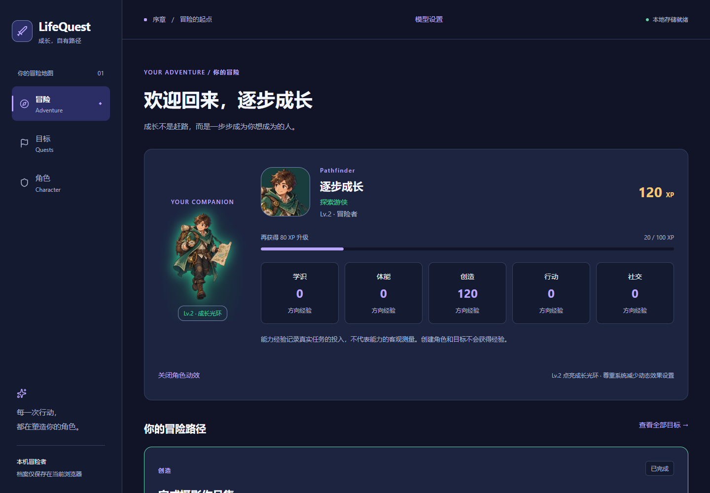
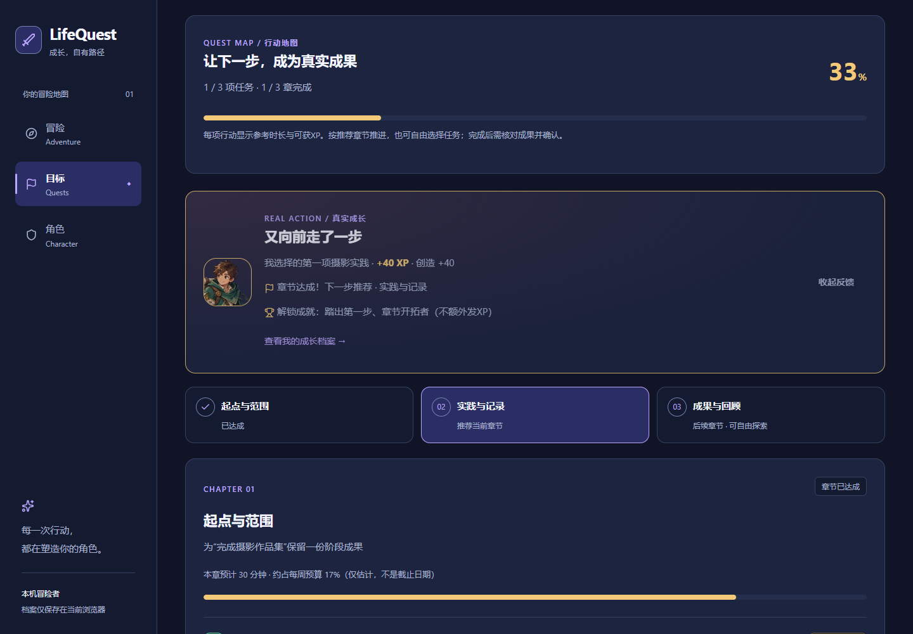
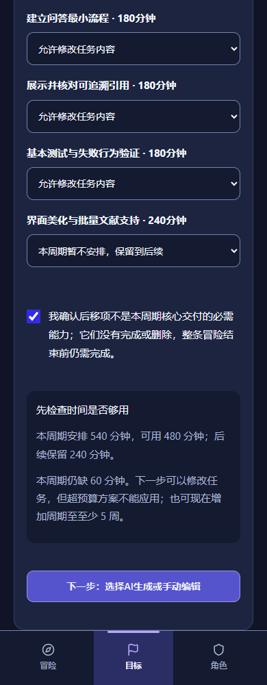

# LifeQuest · 把成长目标变成一场冒险

**一款结合AI规划与RPG角色成长的个人目标管理产品。**

从“想做什么”到“今天做什么”，LifeQuest帮助用户拆解现实目标、执行具体任务，并在时间和状态变化时调整路线。每一次行动，都能在任务进度和角色成长中得到反馈。



## 我在这个项目中做了什么

围绕“目标难拆解、行动难持续、计划跟不上变化”三个问题，完成产品定义、用户流程、交互设计、AI规划方案与评测体系设计，并借助AI辅助开发将方案落地为可交互Web产品。

| 产品工作 | 具体落地 |
| --- | --- |
| 需求分析与范围取舍 | 聚焦个人成长场景，围绕目标、计划、执行、反馈建立主流程；用3条活跃目标与1条重点帮助用户分配注意力 |
| AI功能设计 | 将成功标准、已有基础、时间预算和资源限制纳入规划输入，设计建议审核、用户编辑与正式确认流程 |
| 游戏化机制 | 将任务完成与XP、等级、方向成长和成就关联，形成可追溯的成长反馈 |
| 复杂流程设计 | 支持时间预算变化后的方案调整，联动任务范围、估时与完成标准，提供前后差异审核 |
| AI效果评估 | 设计5类场景、60组固定用例和8项质量标准，完成程序校验与AI辅助预审，建立人工复核工作台和回归方法 |

## 产品体验

### 让下一步足够具体

用户填写成长目标、当前基础、成功标准和每周投入，AI给出章节与任务建议。每项任务包含行动说明、预计投入和完成条件；用户可以修改、增删和排序，确认后开启冒险。

**目标输入 → AI路线 → 用户审核与编辑 → 确认执行 → 成长反馈 → 调整后续计划**

### 让行动看得见

完成任务后，任务地图更新进度，并显示本次XP、方向成长和成就反馈。角色等级与成长流水相互关联，用户能回看每一次进步来自哪项行动。



三种职业提供不同的角色形象与冒险氛围：知识法师、探索游侠、创造工匠。用户按喜好选择角色，自主决定现实目标与成长方向。

### 让计划适应生活的变化

当每周准备时间从5小时变成2小时，用户可输入新预算、执行反馈和待调整任务。系统计算剩余工作与可用时间，提供延期或后移可选工作的选择；修改任务后，通过差异对照确认新方案，已有成果与XP持续保留。



## 一个重点产品案例：5小时变2小时

文献助手项目还剩问答、引用和测试等核心工作。调整的关键在于重新安排交付范围和节奏：先识别必须保留的能力，再处理可推迟的美化与批量支持，最后核对任务行动、估时和验收条件。

这套方案将时间变化转化为用户能够理解和选择的取舍，并把选择落实到具体任务。[阅读产品案例](docs/PORTFOLIO.md)

## AI质量如何衡量

围绕编程学习、AI项目、面试准备、运动习惯和创作实践，建立**60组固定合成输入、8项质量标准**，覆盖不同基础、预算、偏好和资源条件。

评测流程设计为 **程序结构校验 → AI辅助内容预审 → 人工按评分锚点复核**。程序判断计划能否进入产品，AI辅助定位行动、验收和依赖问题，Excel工作台支持人工逐项评分并确认结论。评分和判断依据独立记录，便于复查。

基于生成计划中的问题，梳理“任务描述笼统、范围过大、完成标准难判断”三类原因，优化规划指令，要求任务包含行动对象、操作步骤和可核对成果，并结合用户基础与可用时段检查粒度。运行工具保留固定输入、模型配置、完整计划、延迟和Token，支持同一用例上的回归比较。[阅读评测与改进案例](docs/AI_EVALUATION_CASE_STUDY.md)

规划围绕“成果覆盖、单次行动、完成验收、阶段承接”组织。审核区对照用户原始要求，定位长任务、验收缺口与实践周期；页面与评测共用检查规则，内容质量继续由逐项评分判断。

## 进一步了解

| 文档 | 内容 |
| --- | --- |
| [产品案例](docs/PORTFOLIO.md) | 问题定义、方案取舍与重点场景 |
| [产品需求](docs/PRD.md) | 用户流程、功能设计与业务规则 |
| [AI规划与评测](docs/AI_PLANNER.md) | 模型接入、建议生成和质量评价 |
| [评测与改进案例](docs/AI_EVALUATION_CASE_STUDY.md) | 评测设计、AI辅助人工复核流程与问题驱动优化 |
| [视觉与交互](docs/DESIGN.md) | Arcane Indigo、人物身份与成长反馈 |
| [产品架构](docs/ARCHITECTURE.md) | 草稿、执行计划、成长记录与数据流 |
| [阅读导航](docs/INDEX.md) | 产品材料与代码入口 |

## 本地体验

技术栈：Next.js App Router、React、TypeScript、Tailwind CSS、shadcn/ui；本地快照存储与可替换模型Adapter。

```bash
npm ci
npm run dev
```

打开 http://127.0.0.1:3000 。使用真实模型时，在Git Bash运行 `LIFEQUEST_ENABLE_REAL_LLM=true npm run dev`，进入模型设置选择服务商、模型并输入自己的API Key。数据保存在当前浏览器，Key在当前会话使用。

需要Node.js 22.17或以上。真实模型请求经本机服务端转发；当前服务以本机体验为范围，生产构建关闭模型代理。可用Mock或手动路径体验计划审核、执行与成长。

```bash
npm run lint
npm test
npm run build
npm run typecheck
node scripts/check-portfolio.mjs
```

页面配图来自运行中的产品，使用独立示例档案展示交互。仓库提供当前产品、设计说明、领域测试与固定评测用例；实验批次、逐条评分、工作簿和调试日志留在本机。
