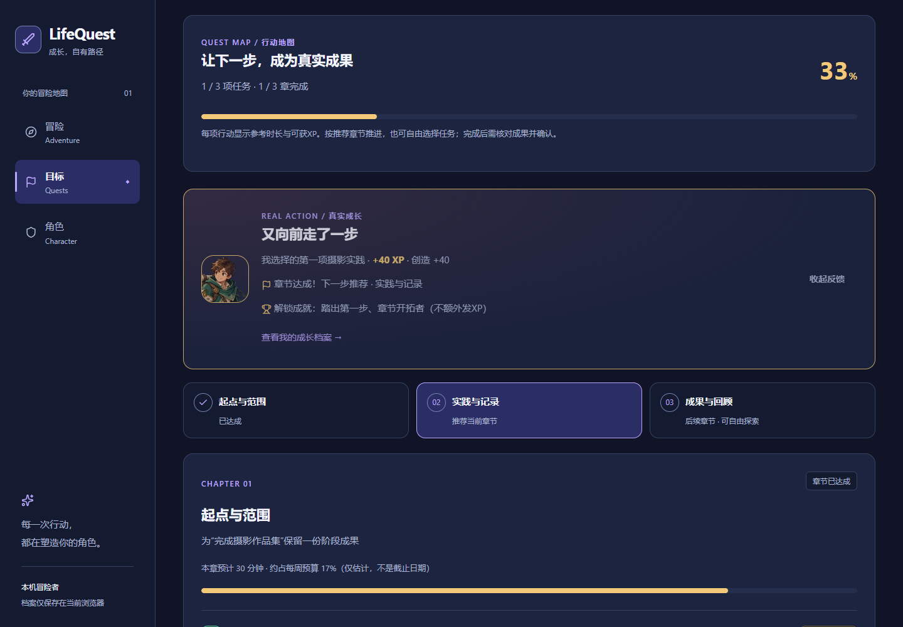

# LifeQuest：从成长目标到持续行动

LifeQuest把AI规划、任务执行和角色成长放在同一条用户路径中：用户先明确想取得的成果，再选择具体行动，通过反馈调整后续安排。

## 从三个实际问题切入

**目标很大，第一步不清楚。** 学习Python、完成作品集、准备面试，都需要从抽象愿望走向具体交付。

**计划有了，行动缺少反馈。** 用户需要看到做完一项任务后离目标更近了多少，也需要直观的正向激励。

**时间变了，计划还停在原地。** 当准备时间减少，原有任务范围、工作量和完成条件需要一起调整。

项目工作覆盖产品定位、功能优先级、流程与交互、AI方案、质量评价及AI辅助落地。

## 用一条完整路径组织体验

创建角色 → 设定目标与成功标准 → 生成或手动规划 → 审核编辑 → 确认执行 → 完成任务 → 查看成长 → 调整后续路线。

| 设计问题 | 产品选择 | 对用户的价值 |
| --- | --- | --- |
| 如何让计划贴合个人情况 | 同时收集基础、时间、偏好和资源条件 | 让建议有明确的出发点 |
| 如何让AI建议容易落地 | 章节里程碑与任务行动、估时、完成标准一起呈现 | 用户能判断下一步做什么、做到什么程度 |
| 如何保留用户的决定权 | 建议审核、编辑草稿、正式确认分开 | 用户可以比较、修改，再选择开始 |
| 如何让成长有来源 | 任务完成触发一次XP结算，形成成长流水 | 角色反馈与实际行动建立联系 |
| 如何分配多目标注意力 | 保留多份草稿，同时最多3条活跃目标和1条重点 | 兼顾探索与当前执行重点 |

## 把游戏化放在行动反馈上

角色承担陪伴与成长表达，任务完成承担奖励触发。轻量、标准、挑战任务分别获得20、40、60 XP；每100 XP升一级，首任务、首章节和首目标形成阶段成就。

这套机制让“制定计划”和“取得进展”有不同反馈：创建目标后获得清晰的路线，完成行动后获得成长。

## 重点案例：每周5小时变成2小时

以完成文献助手为例，核心交付包括文献读取、问答、引用展示和基本测试。场景中用户已完成部分工作，剩余准备时间为4周。

| 项目 | 数量 |
| --- | --- |
| 调整后的每周投入 | 2小时 |
| 4周可用时间 | 480分钟 |
| 剩余核心工作估时 | 540分钟 |
| 可后移的美化与批量能力 | 240分钟 |

即使后移可选工作，核心部分仍有60分钟缺口。系统据此给出延长周期的选择，并支持用户进一步修改未完成任务的行动范围、估时与完成标准。

交互分为四步：**填写变化 → 选择调整方式 → 编辑并核对差异 → 确认应用**。任务范围使用“允许修改”“保持原样”“本周期暂不安排”三种明确选择。调整前后的内容变化与安排变化分别呈现，用户能看清哪些任务改了、哪些只是后移。

完成记录、XP和最终成功标准贯穿前后方案；新方案确认后，用户可以接着完成下一项任务。

## 为AI建立可以复查的评价方式

评测集覆盖5类场景、60组不同合成输入，结合1项程序检查与7项内容评价。设计AI辅助人工评测流程：程序检查结构，AI辅助预审和问题定位，人工按统一锚点评分。工具保留完整输入、计划、配置、延迟、Token和评审依据，并自动整理为Excel。

评价既关注“计划能否正确进入产品”，也关注“用户是否知道如何执行、如何判断完成”。[阅读AI方案](AI_PLANNER.md)

评审将问题归纳为任务粒度、验收可判断性和成果覆盖。规划指令据此按“最终成果—前置能力—独立行动—完成标准—阶段检查点”组织，并区分真实练习、功能交付和诊断记录的验收条件。

例如，“学习数据处理”要落实到读取什么数据、执行什么操作、输出什么结果；五组照片分别完成后，还要安排统一作品集的编排与展示核验。固定用例和评分锚点为这些调整提供回归依据。[评测与改进案例](AI_EVALUATION_CASE_STUDY.md)

## 产品能力的落点

将问题转化为明确的产品约束，将AI能力转化为可审核的交互，将抽象目标转化为可执行任务，再以成长反馈和动态调整把这些环节连接起来。
