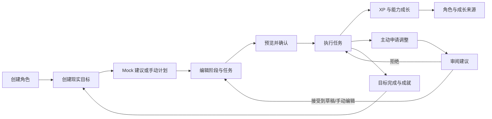

# LifeQuest 产品需求文档

版本：0.1 · 日期：2026-10-20 · 状态：Step 1 规划完成，待用户验收

本文是产品范围和业务规则的基准；技术实现见 [ARCHITECTURE.md](ARCHITECTURE.md)，开发与验收顺序见 [ROADMAP.md](ROADMAP.md)。本文中的范围取舍为建议基线，验收通过后执行。当前尚未开发页面或业务功能。

## 1. 产品定位与待验证假设

LifeQuest 将现实目标转化为用户能够掌控的 RPG 冒险：AI 辅助规划，用户决定计划，真实行动推动角色成长，执行反馈帮助调整后续任务。

首版要验证：用户是否能看懂任务与现实目标、角色能力之间的关系，并愿意在执行后回来记录进展。这里的能力数值代表投入记录，不代表真实能力的客观测量。用户画像与价值判断尚未经过用户研究，不宣称已验证市场需求。

### 核心用户

- 首批：有明确学习、求职或个人项目目标，但不擅长拆解步骤、容易因计划过大而停滞的大学生及年轻职场人。
- 使用前提：愿意自主选择任务并诚实记录完成情况，对 RPG 成长反馈有兴趣。
- 暂不面向：团队项目管理、专业训练处方、依赖严格监督和客观考核的组织。

### 典型场景

| 场景 | 当前困难 | LifeQuest 的帮助 |
| --- | --- | --- |
| 学生完成第一份产品作品集 | 目标大，不知道第一步 | 将交付结果拆成阶段与可验收任务 |
| 上班族准备英语分享 | 可投入时间有限 | 在规划时声明每周投入，执行后主动申请调整 |
| 用户某周精力下降 | 原计划不再适合 | 编辑未完成任务或审阅调整建议，保留已有成果 |

### 核心价值与差异化

1. 每个任务都展示所属阶段、现实完成标准和对目标的贡献，避免只有孤立待办。
2. 每个目标选择一个成长方向，任务完成同时增加角色总 XP 与该方向能力经验；角色页可追溯到实际完成的任务。
3. AI 提议、用户审核、确认执行形成明确边界；重新规划不会覆盖用户已确认的计划。
4. 阶段里程碑、升级和目标成就反馈与真实交付绑定，避免奖励只来自登录或点击。

## 2. 第一阶段 MVP 边界

第一阶段指完整的可交互前端 MVP；本轮 Step 1 只完成其规划。

| 纳入 MVP | 后续再考虑 |
| --- | --- |
| 单浏览器、本地身份、一个角色 | 登录、账号体系、多端同步 |
| 一个进行中的目标，完成后保留历史并可创建下一个 | 同时推进多个目标、团队与社交 |
| 内置头像、昵称、成长方向 | 自定义图片上传、战斗、装备、经济系统 |
| 目标创建、Mock 规划、手动建计划 | 真实 LLM、文件导入与外部工具集成 |
| 阶段/任务增删改和顺序调整 | 日历、周期任务、提醒、复杂依赖图 |
| 计划预览、主动确认、执行中修改未完成部分 | 多人审批、版本回滚、自动后台调度 |
| 任务完成、XP、等级、能力经验、固定成就 | 排行榜、奖励兑换、惩罚或连续签到机制 |
| 用户主动触发的 Mock 调整建议及接受/拒绝 | 自动替用户修改计划、行为预测 |
| localStorage 持久化、刷新恢复、错误提示 | 数据库、云备份、完整导入导出 |

不设置真实登录页。本地身份标明“本机冒险者”，不能让用户误以为数据已保存在账号中。界面持续标明“演示规划器，未接入真实 AI”。

## 3. 完整用户流程

1. 首次进入，查看一句话产品介绍与本地数据提示，创建角色：昵称、内置头像。
2. 创建目标：名称、期望产出/成功标准、成长方向、当前基础、每周可投入时间。
3. 选择“生成建议计划”或“手动创建”。生成不会直接激活目标。
4. 在草稿编辑器中查看阶段、任务、完成标准、预计投入与 XP；可增删改和调整顺序。
5. 点击“预览并确认”，检查完整计划及投入汇总；校验通过并明确确认后开始执行。
6. 在冒险首页选择任务，查看完成标准，实际完成后确认提交，可附一条简短成果记录。
7. 保存成功后结算一次 XP，展示能力增长、升级或阶段达成反馈，返回目标查看进度。
8. 需要调整时主动点击“调整后续计划”，填写执行感受和新的每周投入；审阅 Mock 建议。
9. 可以拒绝建议、手动编辑，或将建议载入编辑草稿；再次确认后替换未完成部分。执行计划在确认前保持原样。
10. 全部任务完成后目标归档，展示成果与对应成长记录；用户可创建下一个目标。

中途离开后恢复到已保存的草稿或执行状态。已有角色时不重复引导；有未完成目标时不允许创建第二个目标，而是继续该目标。

## 4. 信息架构与导航

桌面使用简洁侧栏或顶栏，移动端使用三个主要导航入口：“冒险”“目标”“角色”。RPG 风格主要体现在称谓、插画/头像、能力与成长反馈；表单、错误和操作按钮使用直接、易懂的语言。

| 页面/路由建议 | 内容与关键操作 | 进入/离开 |
| --- | --- | --- |
| `/onboarding` | 产品介绍、创建角色 | 首访进入；完成后到冒险首页 |
| `/` 冒险 | 当前目标、阶段、推荐下一任务、XP 概览 | 无目标时引导创建；有草稿时引导继续编辑 |
| `/goals` 目标 | 当前目标和已完成目标列表 | 进入详情或创建目标 |
| `/goals/new` | 目标输入，生成建议/手动创建 | 保存后进入计划编辑 |
| `/goals/[id]/plan` | 阶段任务编辑、重排、预览确认；调整建议审阅 | 激活后到目标详情；离开前保留已保存草稿 |
| `/goals/[id]` | 现实成果标准、阶段路径、任务、进度、调整入口 | 打开任务详情抽屉；到角色查看成长 |
| `/character` | 角色、等级、五方向经验、成就、成长流水 | 流水可跳转到来源目标与任务 |

任务详情使用抽屉或对话框，不另建复杂任务页面。计划预览使用同一路由的明确预览状态，首次生成和执行中调整共享编辑器。未知目标 ID 显示未找到并提供返回入口。

## 5. 核心业务规则

### 5.1 身份、角色与目标

- 每个本地身份一个角色，昵称 1–20 个字符，头像从内置列表选择；不引入职业加成与复杂初始配点。
- 五个成长方向：学识、体能、创造、行动、社交。用户为目标主动选择一个方向，系统可以建议但不替用户决定。
- 一个非完成目标上限包含草稿或执行中目标；已完成目标只读，允许创建新目标。
- 目标成功标准是用户自己定义的交付结果。系统以计划任务全部完成标记目标完成，不能据此断言用户已经获得真实技能或资格。
- 目标名称 1–80 字符，成功标准 1–500 字符，当前基础 1–500 字符，每周投入 1–40 小时；不设置期限和自动日程，周投入仅供规划与调整参考。
- 首次激活后锁定目标名称、成功标准和成长方向，防止已获 XP 的归属变化；本版允许更新每周投入与调整备注。目标重新定义另建下一目标，取消/放弃目标功能后续再议。

### 5.2 阶段、任务与确认

- 有效计划含 1–10 个阶段、合计 1–50 个任务，每阶段至少一个任务；这是交互和本地数据规模上限，不代表最优规划规模。
- 阶段含名称、里程碑说明和顺序；任务含名称、说明、可检验的完成标准、预计分钟、难度和顺序。
- 阶段名/任务名 1–80 字符；里程碑/任务说明最多 500 字符；完成标准 1–500 字符；预计投入为 5–600 的整数分钟。空白字符不算有效内容。
- 阶段和任务可通过上移/下移排序，键盘可操作；不要求首版实现拖拽。
- 任务属于一个阶段；阶段顺序提供建议路径，不锁住后续阶段任务。首页优先推荐最早未完成阶段中的首个未完成任务。
- 编辑结果和正式执行计划分开；编辑自动保存草稿，预览汇总任务数、总预计投入和可获 XP，不承诺日历排期。
- 只有用户“确认并开始/确认修改”后才成为执行计划。无效/空计划不可确认；校验错误定位到字段。
- 激活后的未完成任务可以编辑、增加、删除或重排，但需要新草稿和重新确认；保留已完成任务及所属阶段，二者不可编辑、删除或移动。
- 已完成阶段不再新增任务；未完成阶段可追加任务。删除/重建未完成任务不产生 XP。
- 进入执行中计划编辑时，可查看当前任务但暂停完成操作；放弃修改需明确确认，返回当前计划。
- 重新生成和采纳建议涉及覆盖草稿时先提示确认；拒绝建议不改变草稿或执行数据。生成中/失败后保留原内容并提供重试或手动编辑。

### 5.3 XP、等级与成就

| 规则 | 首版约定 |
| --- | --- |
| 难度与奖励 | 轻量 20 XP、标准 40 XP、挑战 60 XP；用户可在草稿中修改难度 |
| 奖励依据 | 基于已确认的任务难度；预计分钟只作参考，不直接兑换 XP |
| 完成条件 | 用户核对完成标准并明确确认；成果记录可选，不做上传或自动验证 |
| 总经验 | 所有已完成任务结算 XP 之和；每个任务最多一条结算记录 |
| 能力经验 | 同一份 XP 计入目标所属方向；不再叠加到总 XP，避免算两次 |
| 等级 | `level = 1 + floor(totalXp / 100)`；下一级进度为 `totalXp % 100` |
| 阶段/目标奖励 | 展示里程碑反馈，不额外加 XP |
| 固定成就 | 首次完成任务、首次完成阶段、首次完成目标；每种最多解锁一次 |
| 撤销与刷分边界 | 完成前二次确认，完成后不可撤销或重新领取；首版不做反作弊 |

完成事务必须将任务完成状态与结算记录一起保存；保存失败不显示成功、不增加经验。重复点击或刷新不重复结算。已完成任务名称、难度、成长归属与结算值保留历史快照，不随后续计划调整变化。

示例：目标“完成产品作品集”选择“创造”；“访谈 2 位同学并整理 3 条需求”完成标准具体，难度为标准。完成后获得总 XP 40、创造经验 40；角色页显示该任务是经验来源。累计总 XP 由 80 到 120 时升到 Lv.2，下一级进度 20/100。能力经验反映该方向的任务投入，不用于推断访谈能力水平。

### 5.4 动态调整

- 用户主动申请；首版不定时检查、不后台自动变更。
- 输入包括已有计划、完成情况、执行感受、新的每周投入；Mock 使用固定规则生成说明与建议计划。
- 例如周投入下降时建议减小未完成任务的交付规模与预计投入，并同步重写完成标准，禁止仅缩短时间但保留原要求。
- 展示“建议原因”“当前/建议任务对照”“保留的已完成内容”。首版支持整份建议接受到草稿或全部拒绝；接受后仍可逐项手动编辑，再确认生效。
- 建议不会撤回 XP、修改已完成内容、偷偷保存为正式计划。用户可直接手动调整，无需使用规划器。

### 5.5 数据与体验边界

- 首版只在当前浏览器与站点来源下保存；清除站点数据、换设备或换访问地址可能无法取回数据，Git 不备份浏览器数据。
- 草稿自动保存结果必须可见；写入失败显示“未保存”，保留当前内存输入，允许重试。读取损坏数据时不得静默清空。
- 首版支持单标签页编辑；其他标签页写入后提示重新加载，禁止继续用旧数据覆盖。详细策略见架构文档。
- 不提供清空数据、云同步和数据修复工具；演示与验收使用浏览器隔离上下文。
- MVP 使用中文、响应式布局，核心操作可键盘完成；升级动画可跳过，不阻挡继续执行任务。

## 6. 验收与验证方向

端到端验收：首次进入 → 建角 → 建目标 → 生成建议 → 修改/新增/删除/排序 → 确认 → 完成任务 → 正确成长 → 刷新恢复 → 拒绝与接受调整 → 完成目标 → 创建下一目标。

重点边界：空计划、重复完成、存储失败、非法数据、草稿退出恢复、编辑期间任务结算、调整保留已完成任务、旧标签页覆盖。

使用验证通过人工观察和访谈记录，不接入分析 SDK：用户能否独立确认第一份计划、是否能解释能力经验来源、调整是否让后续任务更可执行、首次真实完成后是否愿意继续。首版不设置未经验证的增长指标或留存达标承诺。

## 7. 待验收的关键取舍

建议先采用：单目标、五方向经验、固定 XP、完成不可撤销、用户主动触发调整。它们将实现范围集中在可信的成长闭环。若验收时改变这些决定，应先同步本文、架构模型及路线图，再启动开发。
